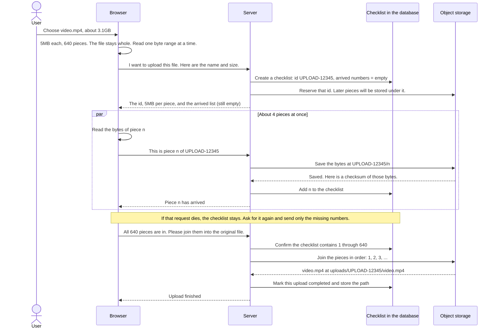

# How a large upload continues after the connection drops

Chinese version: [upload-huge-file-by-chucks.md](./upload-huge-file-by-chucks.md)

A 3GB file sent as one request has to start over if the connection dies at 90%. So the browser does not send the whole file at once. It reads one byte range at a time. The server keeps a checklist of which ranges have arrived. After a drop, the browser sends only the missing ranges. When every range is in, object storage joins them in order and the original file is back.

The file on disk stays one file. A "piece" is a read of one range:

```text
video.mp4 (3.1GB, still one file)
|-- piece 1: first 5MB --|-- piece 2: next 5MB --| ... |-- piece 640 --|
```

Two places hold different things:

```text
Object storage holds the bytes. While the upload is in progress, each piece sits alone:
  UPLOAD-12345/1
  UPLOAD-12345/2
  UPLOAD-12345/5

The database holds no video. It holds a checklist of piece numbers that have arrived:
  arrived [1, 2, 5]
  so pieces 3 and 4 still need to be sent
```

`[1, 2, 5]` is just the piece numbers. The path `UPLOAD-12345/5` is where piece 5's bytes are stored.

## One upload, from start to file



Reading the diagram from top to bottom:

1. The user picks the file. The browser divides file size by piece size. Piece 1 is the first 5MB, piece 2 is the next 5MB, and the last piece is usually shorter.
2. The browser sends the file name and size. The server does two things before any video bytes move: it writes an empty checklist in the database, and it reserves an id in object storage so each later piece has a place to land.
3. The browser reads piece n and sends it with the upload id and the piece number. About 4 pieces are in flight at once. The piece number is that range's position in the original file.
4. Object storage writes those bytes at `UPLOAD-12345/n`. It returns a checksum so the saved bytes can be matched to what was sent. The server adds n to the checklist.
5. When the checklist contains 1 through 640, the server tells object storage to join the pieces into `video.mp4` and stores that path. The joined object is the file.

The browser reads one range. The whole file is not loaded into memory:

```ts
const CHUNK_SIZE = 5 * 1024 * 1024;
const totalChunks = Math.ceil(file.size / CHUNK_SIZE);

function sliceForChunk(file: File, chunkNumber: number): Blob {
  const start = (chunkNumber - 1) * CHUNK_SIZE;
  const end = Math.min(start + CHUNK_SIZE, file.size);
  return file.slice(start, end);
}
```

The database row tracks progress. It does not contain the video:

```ts
{
  id: "UPLOAD-12345", // this upload's id, sent with every piece
  fileName: "video.mp4",
  fileSize: 3355443200,
  chunkSize: 5242880, // 5MB per piece, chosen by the server
  totalChunks: 640,
  arrived: [1, 2, 3, 4, 5], // the checklist. Numbers only. Missing numbers still need to be sent.
  checksums: {
    1: "a1b2", // checksum of piece 1, handed to storage when the pieces are joined
    2: "c3d4"
  },
  status: "uploading", // becomes completed after the pieces are joined
  filePath: "" // set when the file exists, for example uploads/UPLOAD-12345/video.mp4
}
```

## The page is refreshed

The checklist is still on the server. The file the browser was holding is gone.

The user picks the same file again. The browser checks the name and size, asks the server for the checklist, and sends only the piece numbers that are not on it.

## The same piece is sent twice

The piece was saved, but the reply never reached the browser, so the browser sends it again. A resume can also resend a number that is already on the checklist.

Piece n is always written at `UPLOAD-12345/n`. Sending it again overwrites that same piece. The checklist still contains a single n. The checksum is replaced with the checksum from this save.

Done means every number from 1 to 640 is on the checklist. Sending one piece twice does not add an extra number, and it does not fill a gap.

## How big each piece is

The piece size is how much must be sent again when that request fails.

- 5MB and 10MB are the usual choices. A failed piece is small enough to resend, and the number of requests stays reasonable.
- Smaller pieces turn 640 requests into thousands.
- Larger pieces make one failure expensive to resend.
- A piece also has to finish before the request times out. On a slow phone connection, use 5MB or 10MB.

Object storage adds three limits: every piece except the last is at least 5MB, there are at most 10,000 pieces, and the joined file is at most 5TB. At 5MB per piece, that covers files up to about 50GB. For a larger file, use a larger piece so the count stays within 10,000.

## Many people uploading at once

If every video byte passes through the application servers, those servers run out of bandwidth first. The servers should keep the checklist.

After the server checks that this user is allowed to upload, it gives the browser a short-lived permission for each piece. The browser uses that permission to put the bytes directly into object storage. It then tells the server the piece number and the checksum, and the server adds that number to the checklist.

Each user uploads about 4 pieces at a time. If a checklist is still unfinished after a day, delete the unjoined pieces in object storage so half-finished uploads do not keep using space. Virus scanning and transcoding run after the file has been joined.
